# 彩雲 取扱説明書

彩雲は、軽快な動作と快適な読書を目指したEPUBリーダーです。日本語環境では「彩雲」、その他の環境では「Saiun」と表示されます。

本書は **0.1.0-1相当のUbuntu版** を対象にしています。画面例はUbuntu 26.04.1 / GNOME Wayland / 表示倍率200%の実機で撮影しました。ウィンドウの大きさや設定によって配置・ページ数は変わります。

[導入](#1-インストールと起動) · [本棚](#3-本棚を使う) · [読書操作](#4-読むページを送る) · [目次・しおり](#5-目次としおり) · [読書設定](#6-文字とレイアウトを調整する) · [アプリ設定](#8-本棚のアプリ設定) · [削除](#9-本を本棚から削除する)

## 1. インストールと起動

### .debで導入する

1. [Releases](https://github.com/Nanashisan6400/saiun/releases)で、使用する版の`.deb`をダウンロードします。非公開リポジトリの場合は、閲覧権限のあるアカウントでログインしてください。
2. `.deb`を置いたフォルダをターミナルで開きます。
3. 次を実行します。管理者パスワードを求められます。

```sh
sudo apt install ./saiun_0.1.0-1_all.deb
```

依存パッケージもUbuntuのパッケージ管理で導入されます。上のファイル名は導入する版に合わせて変更してください。

チェックサムの添付がある場合は、`.deb`と同じフォルダで確認できます。

```sh
sha256sum -c saiun_0.1.0-1_all.deb.sha256
```

アプリ一覧の「彩雲」または「Saiun」から起動します。ターミナルからは`saiun`で起動できます。

現在の動作確認環境はUbuntu 26.04 / GNOME Waylandです。ソースからの起動は[Ubuntu版の案内](../ubuntu/README.md)を参照してください。

## 2. 本を取り込む

本棚左上の **「取り込む」** を押し、EPUBを選択して取り込みます。EPUBファイルを本棚へドラッグ＆ドロップすることもできます。

- 対象はDRMのないEPUBです。
- EPUB構造を持つ`.zip`と、展開済みEPUBのフォルダも取り込めます。任意のZIPや画像集を読めるという意味ではありません。
- 元ファイルはアプリの保存領域へコピーされます。元の本は書き換えません。
- 同じ内容のファイルを再度取り込んだ場合は重複をまとめ、既存の位置や設定を保ちます。同じタイトルでもファイルの内容が違う版は別の本です。
- アプリは本を配布していません。読む権利のあるEPUBを用意してください。

## 3. 本棚を使う

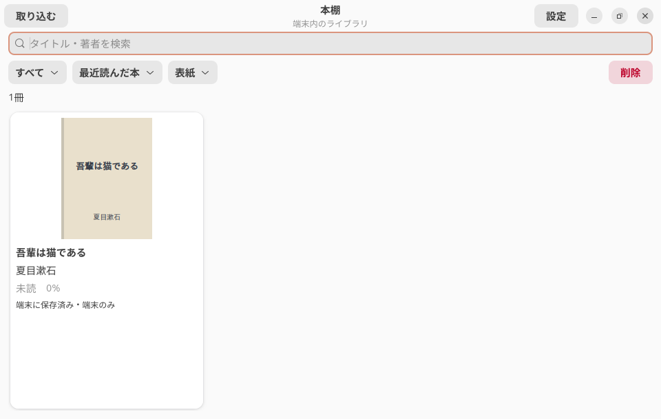

本を押すと読書画面を開きます。表紙のない本には、タイトル・作者名入りの簡易表紙を表示します。

| 操作 | 使い方 |
|---|---|
| 検索 | 「タイトル・作者を検索」に入力する |
| 絞り込み | 「すべて」から未読・読書中・読了等を選ぶ |
| 並べ替え | 「最近読んだ本」から追加順・タイトル・作者等を選ぶ |
| 表示切替 | 「表紙」を「一覧」へ切り替える |
| アプリ全体の設定 | 右上の「設定」を押す |

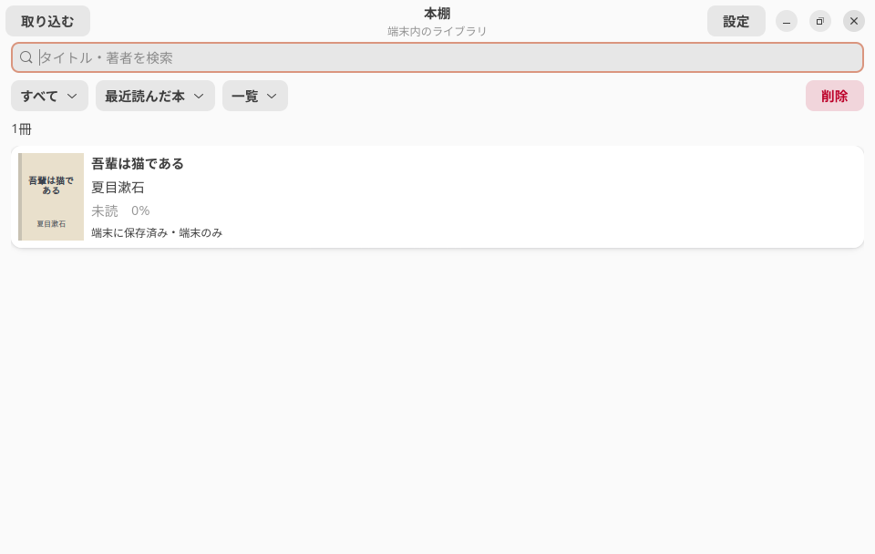

「標準書式」と表示される本は、著者CSSの一部を扱えないため内蔵の書式で開いています。本文の互換表示であり、元のEPUBを書き換える処理ではありません。

### 未読・読書中・読了

進捗が0の位置は未読、途中は読書中、巻末の最終ページまで進むと読了になります。巻末から戻ると読了は解除されます。手動で状態を指定する操作はありません。

進捗は原本内の位置から計算した値で、紙の本のページ番号とは対応しません。

## 4. 読む・ページを送る

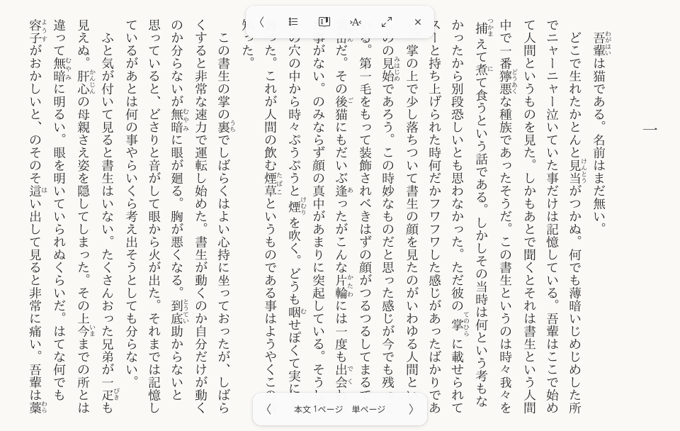

本文中央をタップ、またはマウスで左クリックすると、操作バーの表示・非表示を切り替えます。表示したバーは最後の操作から約5秒で隠れます。目次や設定を開いている間は表示を保ちます。

上の操作バーには、左から次の操作があります。

| アイコン | 操作 |
|---|---|
| 左向きの山形 | 本棚へ戻る |
| 横線の一覧 | 目次を開く |
| しおりの付いた本 | しおりメニューを開く |
| 文字のアイコン | 読書設定を開く |
| 斜めの矢印 | 全画面を切り替える |
| × | 操作バーを隠す |

本文中のリンクへ移動した後は、リンク元へ戻るボタンが追加されることがあります。

### ページ送り

- 下の左右ボタン、本文の左右端のタップ、横スワイプ、マウスホイールで移動します。
- ページが進む側は本のページ進行に従います。通常の縦書きでは左へ進み、右へ戻ります。
- 文字選択やリンク操作、設定メニューの操作中は、通常のページ送りと区別して扱います。

| キーボード | 操作 |
|---|---|
| `Page Down` / `Page Up` | 次 / 前のページ |
| 左右矢印 | 本のページ進行に応じて次 / 前へ移動 |
| `Space` / `Menu` | 操作バーを表示・非表示 |
| `F11` | 全画面を切り替える |
| `Esc` | 操作バーを閉じる。閉じた状態では全画面を解除 |
| `Alt` + `←` | 本文リンクの移動元へ戻る |

入力欄やメニューを操作している場合は、その操作が優先されます。

### 続きから読む

読書位置は自動で保存されます。本を開き直すと保存位置から再開します。文字サイズやウィンドウ寸法を変えても、原本の同じ位置付近を表示するよう調整します。

表示するページ番号は一時的なものです。文字サイズ・向き・見開き・読み込み範囲によって変わるため、番号が変わっても読書位置を失ったとは限りません。

## 5. 目次としおり

### 目次から移動する

操作バーの目次アイコンを押します。現在読んでいる章の項目付近から表示します。項目を押すとその章へ移動します。

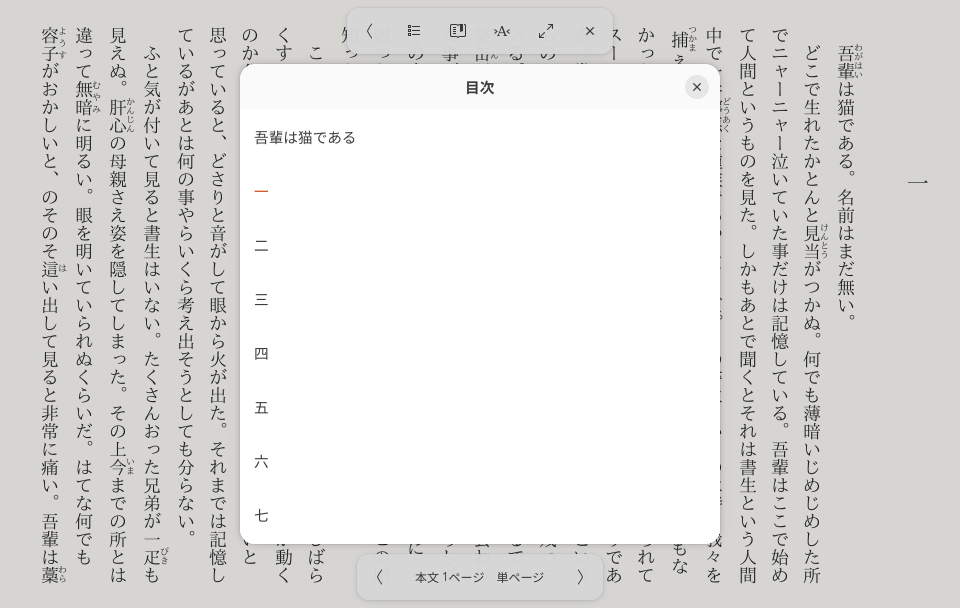

### しおりを追加する・外す

1. しおりアイコンを押します。
2. **「現在位置のしおりを追加／削除」** を押します。
3. 同じ位置でもう一度実行すると、しおりを外します。

しおりメニューの **「しおり一覧」** を押すと、保存済みの位置へ戻れます。しおりがない場合は通知を表示します。

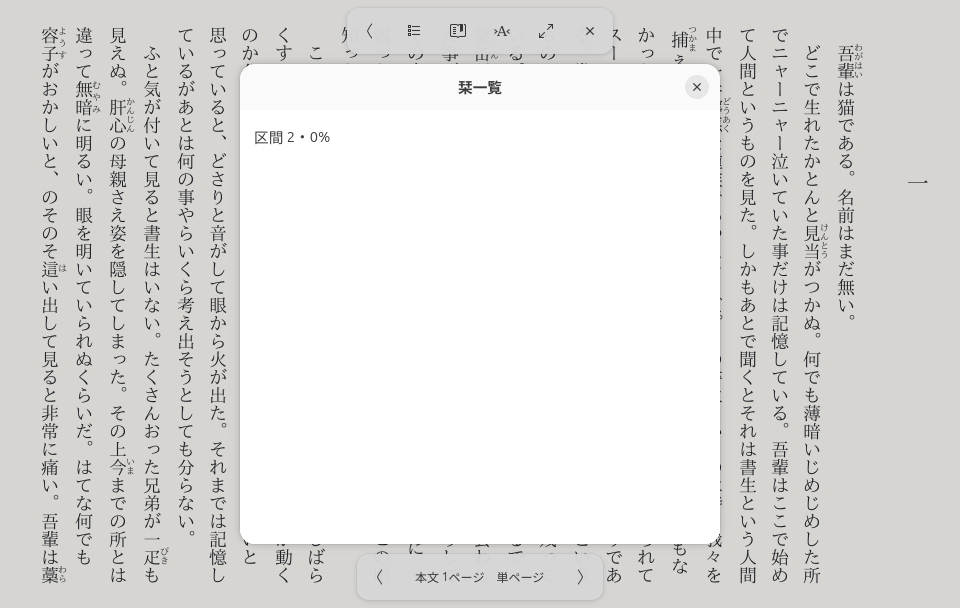

## 6. 文字とレイアウトを調整する

文字のアイコンを押して読書設定を開きます。操作すると、後ろの本文へ反映されます。変更内容は **書籍ごと** に保存し、ほかの本には適用しません。

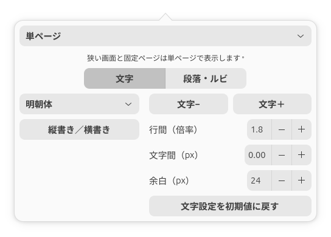

| 設定 | 内容 |
|---|---|
| 文字− / 文字＋ | 本文の文字サイズを変更。10〜48px |
| 書体 | 明朝体・ゴシック体・書籍の書体・インストール済み書体から選択 |
| 縦書き／横書き | 書字方向を切り替える |
| 行間 | 1.0〜3.0倍 |
| 文字間 | -1.0〜8.0px |
| 余白 | 上下左右共通で4〜80px |
| 文字設定を初期値に戻す | 文字18px・行間1.8倍・文字間0px・余白24pxへ戻す |

初期値ボタンが戻すのは上記の4項目です。書体・表示方向・見開き・段落設定は維持します。

明朝体は内蔵のIPAex明朝、ゴシック体はIPAexゴシックです。「書籍の書体」は本の指定を使います。書体の一覧では検索もできます。文字が出ない場合は、別の対応書体も試してください。

### 段落・ルビ

**「段落・ルビ」** タブを選びます。

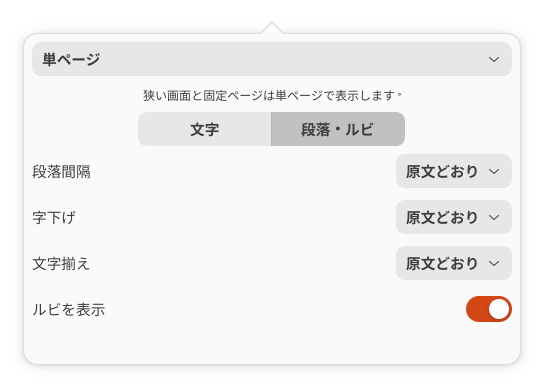

| 設定 | 選択肢 |
|---|---|
| 段落間隔 | 原文どおり / なし / 0.5・1・1.5・2・3字 |
| 字下げ | 原文どおり / なし / 1・2字 |
| 文字揃え | 原文どおり / 行頭揃え / 両端揃え |
| ルビを表示 | オン / オフ |

「字」は本文の文字サイズを基準にした量です。段落設定は本文の段落に適用します。見出しや特殊な書式では効果が異なることがあります。初期状態は原文の段落設定を保ち、ルビを表示します。

## 7. 見開き・横書き・固定ページ

読書設定の上段で **「単ページ」「見開き」「自動」** を選びます。自動では、本文領域が横長で幅800論理px以上の場合に見開きにします。見開きを指定しても、狭い画面では単ページになります。

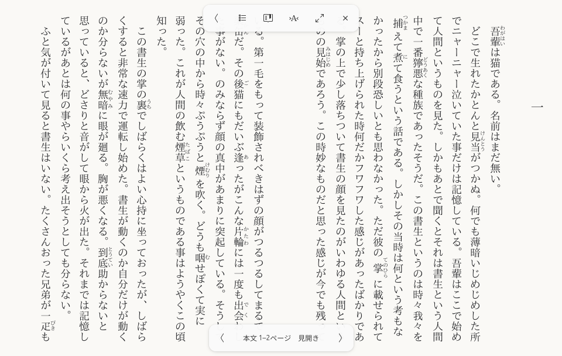

見開きでは2ページずつ送ります。左右の配置は本のページ進行に従います。末尾が奇数ページの場合は、もう片側が空白になります。

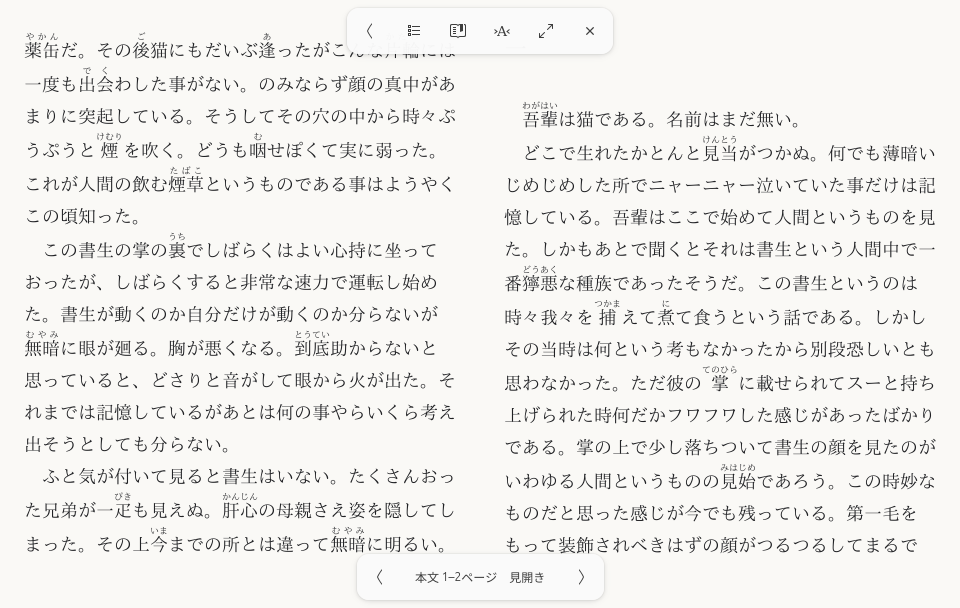

横書きへ変更しても、本にページ進行の指定がある場合はその指定を優先します。

固定ページの本は単ページで表示し、読書設定に「拡大」「縮小」「全体表示」を表示します。拡大中はドラッグやホイールでページ内を移動できます。文字サイズ・段落などのリフロー用設定は固定ページへ適用しません。

## 8. 本棚のアプリ設定

本棚右上の **「設定」** を押します。配色と読書キャッシュ容量はアプリ全体の設定です。

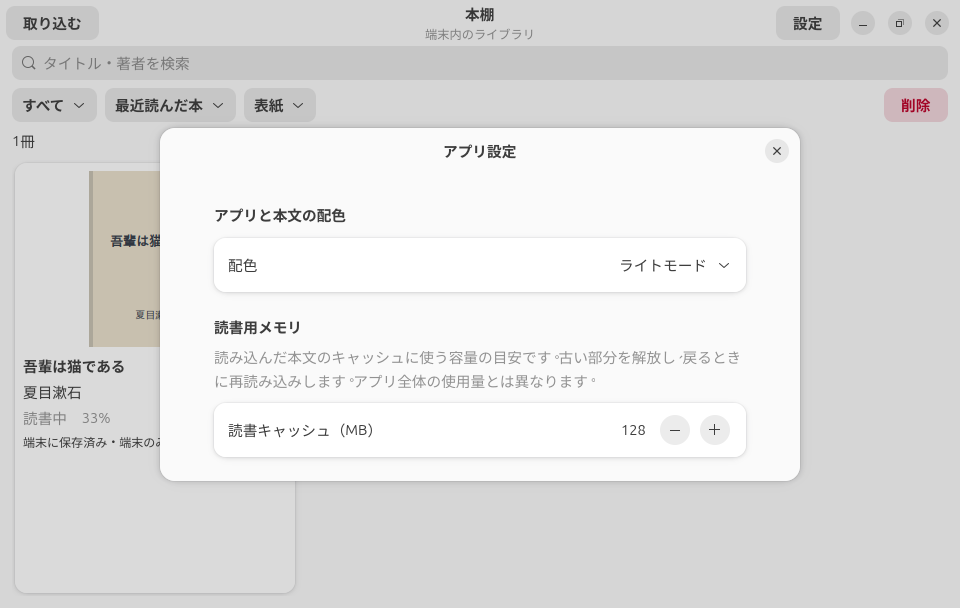

### 配色

「OSに合わせる」「ライトモード」「ダークモード」を選びます。アプリの操作画面と本文へ反映します。

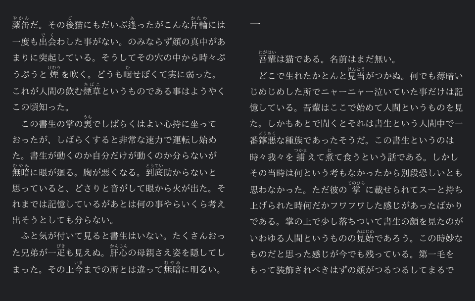

### 読書キャッシュ

読み込んだ本文を保持する容量の目安を **32〜512MB** で指定します。初期値は128MBです。

予算に達すると、現在位置を保ちながら古い表示データを解放します。古い範囲へ戻るときは再読み込みするため、少し待つ場合があります。これはアプリ全体のメモリ使用量を指定値に固定する設定ではありません。

## 9. 本を本棚から削除する

1. 本棚の **「削除」** を押します。
2. 削除する本を押します。選んだ本に枠と背景色が付きます。もう一度押すと解除します。
3. **「実行（冊数）」** を押します。
4. 書名と削除対象を確認して「削除」を押します。

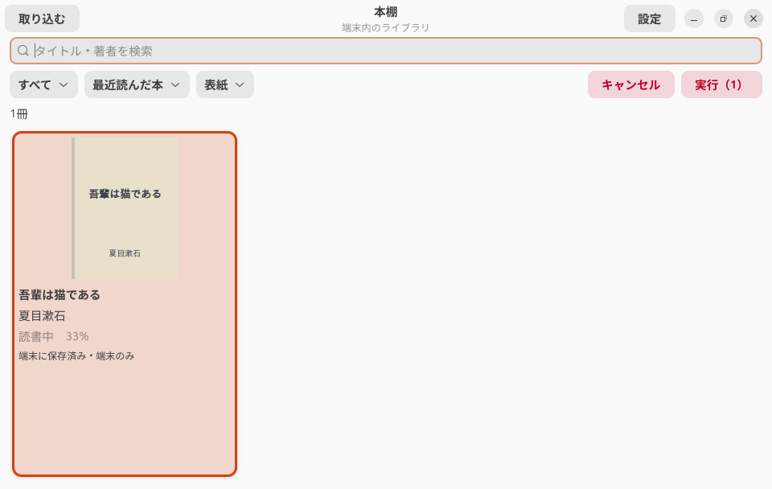

**アプリ内の本体・しおり・読書位置・書籍設定が削除されます。元のファイルやフォルダは残ります。** 同じ本を取り込み直しても、削除した位置やしおりは復元されません。

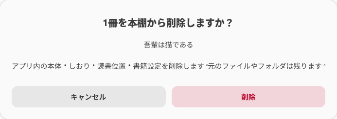

やめる場合は「キャンセル」を押します。確認画面を閉じ、選択モードの「キャンセル」または`Esc`で通常の本棚へ戻れます。

## 10. 更新・保存場所・アプリの削除

更新は、新しい版の`.deb`を同じようにインストールします。更新前に彩雲を終了してください。

```sh
sudo apt install ./saiun_更新版のバージョン_all.deb
```

既定の本棚保存先は`~/.local/share/ebookproject-reader/`です。内部名は旧開発名を維持しています。ソース版と.deb版は、同じユーザーならこの本棚を使います。

アプリだけを削除するには次を実行します。

```sh
sudo apt remove saiun
```

パッケージ削除はユーザーの本棚や元のEPUBを削除しません。以前ソース版から登録した起動アイコンがある場合は、そのアイコンが優先されることがあります。

## 11. 困ったとき

| 状況 | 確認すること |
|---|---|
| 起動しない | Ubuntuの版、GNOME Waylandセッション、依存パッケージを確認し、ターミナルで`saiun`を実行してエラーを確認する |
| 本を取り込めない | DRMの有無、EPUBの構造、ファイルの破損を確認する。外部資源や安全上限を超える入力は扱えない場合がある |
| 書籍の書式と違う | 「標準書式」の表示と読書設定を確認する |
| 文字設定が効かない | 固定ページか確認する。固定ページでは拡大・縮小を使う |
| 次の範囲へ進む際に待つ | 本文は小さな範囲を順に読み込む。長い本文や多数のルビでは準備に時間がかかる場合がある |
| 読書設定がほかの本と違う | 読書設定は書籍別。アプリ設定の配色・キャッシュ容量だけが共通 |
| 別の端末に本棚が出ない | 現在は端末内の読書用。クラウド同期は提供していない |

不具合は[Issue](https://github.com/Nanashisan6400/saiun/issues)へ、Ubuntuの版・再現手順・期待した動作・実際の動作を添えて報告してください。書籍本文や個人情報を無断で添付しないでください。Pull Requestは受け付けていません。

## 画面例と出典

画面例は、実機に保存された夏目漱石『吾輩は猫である』の青空文庫由来EPUBを、撮影用の別本棚で開いたものです。表示例を1冊に絞り、アプリが生成する簡易表紙を使用しています。常用本棚の読書位置・設定・しおりは変更していません。

本文・書誌情報の出典と撮影条件は[画面例の出典](SCREENSHOT_CREDITS.md)を参照してください。EPUB本体・ユーザーのDB・読書記録は配布していません。
